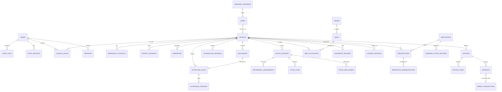

# Calyvia Wellness Center Management System — Architecture & System Design Document

**Document Version:** 1.0.0  
**Target Facility:** Calyvia Wellness Center (Mugutha, Ruiru, Kiambu County, Kenya)  
**Author:** Principal Software Engineer & Solution Architect  
**Status:** PROPOSED (Pending Client Approval)

---

## 1. Executive Summary & System Context

Calyvia Wellness Center is a specialised addiction treatment and mental health rehabilitation facility near Nairobi, Kenya. The facility provides inpatient rehabilitation, medically guided detoxification, psychiatric evaluation, individual and group psychotherapy, family therapy, and structured aftercare.

The **Calyvia Wellness Center Management System** is a mission-critical, backend-first healthcare management platform (HMIS/EMR) with an integrated administrative and clinical staff portal. It digitises the entire patient journey end-to-end:
$$\text{Enquiry} \longrightarrow \text{Triage \& Assessment} \longrightarrow \text{Admission} \longrightarrow \text{Detoxification} \longrightarrow \text{Inpatient Therapy} \longrightarrow \text{Discharge} \longrightarrow \text{Relapse Prevention \& Aftercare}$$

In parallel, the system manages core clinical and business operations:
- Kenya M-Pesa (Safaricom Daraja API) billing, invoicing, and receipting
- Real-time room and bed allocation with occupancy tracking
- Pharmacy inventory with Medication Administration Records (MAR) and automated low-stock/expiry tracking
- Incident, movement, and visitor safety management
- Kenya Data Protection Act (KDPA 2019) compliance with field-level encryption for substance-use notes and immutable audit logs.

```mermaid
flowchart TD
    subgraph Public_Clients["External Channels & Public Entry"]
        WebSite["calyviawellness.co.ke (Website Lead Webhook)"]
        WhatsApp["WhatsApp Bot / Direct Inquiries"]
        Phone["Direct Front Desk Phone / Walk-in"]
        MPesa["Safaricom M-Pesa Daraja Gateway"]
    end

    subgraph Calyvia_Ecosystem["Calyvia Management System Platform"]
        subgraph Frontend_Layer["Presentation Layer (apps/admin)"]
            NextAdmin["Next.js Staff & Clinical Dashboard<br/>(Tailwind CSS + shadcn/ui + WCAG AA)"]
        end

        subgraph Gateway_Security["Security & API Boundary"]
            ReverseProxy["Nginx / Reverse Proxy & SSL"]
            APIGateway["NestJS API (apps/api) /api/v1<br/>Helmet • Rate Limiting • JWT • RBAC Guards • Audit Interceptor"]
        end

        subgraph Core_Services["28 Modular Domain Engines"]
            direction TB
            M_Patients["Patient & Family Management"]
            M_CRM["CRM, Admissions & Referrals"]
            M_Clinical["Clinical Records & Versioned Notes"]
            M_Detox["Detoxification & Withdrawal Monitoring (CIWA/COWS)"]
            M_Therapy["Counselling, Therapy & Appointments"]
            M_Pharmacy["Pharmacy & e-MAR Dispensing"]
            M_Rooms["Rooms & Bed Occupancy Engine"]
            M_Billing["Billing, Invoicing & Daraja M-Pesa Engine"]
            M_Operations["Staff, Tasks, Inventory & Incidents"]
            M_Discharge["Discharge & Aftercare Cadence"]
            M_Comms["Communication & Automation (BullMQ)"]
            M_Governance["Audit Trail, KDPA 2019 Encryption & RBAC"]
        end

        subgraph Persistence_Layer["Data & State Infrastructure"]
            PostgreSQL[("PostgreSQL 16 Enterprise<br/>(Prisma ORM + UUIDs + AES-256 Clinical Encryption)")]
            Redis[("Redis 7.2 (Cache, Session Invalidation & BullMQ Queues)")]
            MinIO[("Secure S3-Compatible Object Storage<br/>(Encrypted Clinical Forms & Scans)")]
        end
    end

    WebSite -->|HTTPS Webhook| APIGateway
    MPesa <-->|STK Push & C2B Callbacks| APIGateway
    NextAdmin <-->|REST API + Bearer JWT| APIGateway
    APIGateway --> Core_Services
    Core_Services <--> PostgreSQL
    Core_Services <--> Redis
    Core_Services <--> MinIO
```



---

## 2. Monorepo Architecture & Project Layout

The repository is structured as a TypeScript monorepo with strict package boundaries:

```text
/
├── apps/
│   ├── api/                           # NestJS 10+ REST API Application
│   │   ├── src/
│   │   │   ├── common/                # Shared decorators, guards, filters, interceptors
│   │   │   │   ├── crypto/            # AES-256-GCM field encryption service
│   │   │   │   ├── decorators/        # @CurrentUser(), @AuditLog(), @Roles()
│   │   │   │   ├── filters/           # Global HttpExceptionFilter
│   │   │   │   ├── guards/            # JwtAuthGuard, RolesGuard, ConsentGuard
│   │   │   │   ├── interceptors/      # AuditLogInterceptor, TransformResponseInterceptor
│   │   │   │   └── utils/             # Phone normalizer (+254), Nairobi date helpers
│   │   │   ├── config/                # App, Database, Redis, M-Pesa, AWS S3 configs
│   │   │   ├── database/              # PrismaService, transaction managers, seed runner
│   │   │   ├── modules/               # 28 dedicated NestJS domain modules (1-28)
│   │   │   └── main.ts                # Bootstrap, Swagger docs, validation pipe, helmet
│   │   ├── test/                      # End-to-end (e2e) Supertest suites
│   │   └── Dockerfile
│   │
│   └── admin/                         # Next.js 15+ App Router Dashboard
│       ├── src/
│       │   ├── app/                   # Next.js App Router pages & layouts
│       │   │   ├── (auth)/            # Login, password reset, 2FA
│       │   │   ├── (dashboard)/       # Clinical & Admin workflows
│       │   │   │   ├── patients/      # Patient charts, vitals, admissions
│       │   │   │   ├── crm/           # Leads pipeline, referrals, inquiries
│       │   │   │   ├── clinical/      # Doctor notes, nursing notes, reviews
│       │   │   │   ├── detox/         # Withdrawal charts, CIWA/COWS, MAR
│       │   │   │   ├── counselling/   # Therapy sessions, treatment plans
│       │   │   │   ├── pharmacy/      # Drug stock, prescriptions, dispensing
│       │   │   │   ├── rooms/         # Interactive bed occupancy board
│       │   │   │   ├── billing/       # Invoices, M-Pesa STK trigger, receipts
│       │   │   │   ├── staff/         # Staff roster, attendance, certificates
│       │   │   │   ├── inventory/     # Store stock, procurement, alerts
│       │   │   │   ├── discharge/     # Checklists, summaries, aftercare plans
│       │   │   │   └── reports/       # Filterable reports & PDF/CSV export
│       │   │   └── api/               # Next.js BFF proxy / session routes
│       │   ├── components/            # UI components (shadcn/ui customized with Calyvia tokens)
│       │   ├── hooks/                 # Custom React query hooks
│       │   ├── lib/                   # API client, Nairobi date utils, currency formatters
│       │   └── styles/                # Tailwind CSS globals with Calyvia brand variables
│       └── Dockerfile
│
├── packages/
│   └── shared/                        # Shared TypeScript Library
│       ├── src/
│       │   ├── enums/                 # Roles, statuses, admission stages, substance types
│       │   ├── dtos/                  # Request/Response contracts & Zod schemas
│       │   ├── interfaces/            # Common domain interfaces
│       │   └── constants/             # Error codes, Kenya county codes, permissions
│       └── package.json
│
├── prisma/
│   ├── schema.prisma                  # Comprehensive relational database schema
│   ├── migrations/                    # Version-controlled SQL migration scripts
│   └── seed/                          # Realistic fictional seed data for all 28 modules
│
├── docs/
│   ├── architecture.md                # System design & ADR document (this document)
│   ├── design-system.md               # Calyvia brand UI tokens & components
│   ├── compliance-kdpa.md             # Kenya Data Protection Act compliance specification
│   ├── api-specs.md                   # REST API and M-Pesa callback specifications
│   └── runbooks/                      # Deployment, backup, and restore guides
│
├── docker-compose.yml                 # Local & staging orchestration (API, Admin, Postgres, Redis)
└── .github/workflows/ci.yml           # Automated lint, typecheck, unit, e2e & Playwright tests
```

---

## 3. Scope: 28 Modules Breakdown & Dependency Map

Every module is built as an independent, encapsulated NestJS module containing its own entities, DTOs, service, controller, and unit/e2e tests:

| # | Module Name | Core Responsibilities | Key Dependencies |
| :--- | :--- | :--- | :--- |
| **01** | `PatientsModule` | Master Patient Index (MPI), demographic records, emergency contacts, legal consents, document attachments, advanced patient search. | `SecurityModule`, `AuditModule`, `DocumentsModule` |
| **02** | `CrmAdmissionsModule` | Intake funnel, website enquiry webhook processor, lead tracking, admissions pipeline, pre-admission assessments, waitlist management. | `PatientsModule`, `CommunicationModule`, `ReferralModule` |
| **03** | `ClinicalRecordsModule` | Psychiatric and general doctor notes, nursing shift logs, multidisciplinary treatment plans, ICD-10 diagnoses, versioned clinical notes. | `PatientsModule`, `SecurityModule`, `AuditModule` |
| **04** | `DetoxModule` | Medically guided detox protocols, substance abuse history, withdrawal score calculation (CIWA-Ar for alcohol, COWS for opioids), vitals monitor, detox completion certification. | `PatientsModule`, `ClinicalRecordsModule`, `PharmacyModule`, `RoomsModule` |
| **05** | `CounsellingModule` | Individual, group, family, and adolescent counselling records, therapy goal trackers, progress notes, attendance logs. | `PatientsModule`, `AppointmentsModule`, `StaffModule` |
| **06** | `AppointmentsModule` | Multi-disciplinary calendar: psychiatric reviews, therapy sessions, doctor consultations, family visitation, automated SMS/WhatsApp reminders. | `PatientsModule`, `StaffModule`, `CommunicationModule` |
| **07** | `BillingModule` | Invoicing, fee structures (detox package, daily inpatient rate, counselling fees), receipting, credit notes, payment plans, Safaricom M-Pesa Daraja STK Push & C2B callbacks. | `PatientsModule`, `CrmAdmissionsModule`, `RoomsModule`, `PharmacyModule` |
| **08** | `PharmacyModule` | Medication inventory, formulary management, electronic prescriptions, Medication Administration Record (e-MAR), batch tracking, expiry & reorder alerts. | `PatientsModule`, `ClinicalRecordsModule`, `DetoxModule`, `BillingModule` |
| **09** | `RoomsModule` | Room inventory, bed availability visual grid, admission bed assignment, inter-ward transfers, real-time occupancy rate tracking. | `PatientsModule`, `CrmAdmissionsModule`, `BillingModule` |
| **10** | `MovementVisitorsModule` | Patient movement tracking (leaves of absence, medical escort, court visits), visitor registration, approved visitor lists, visitation logs. | `PatientsModule`, `SecurityModule` |
| **11** | `IncidentsModule` | Critical incident logging (absconding/elopement, medical emergencies, contraband detection, self-harm risks), investigation records, corrective actions. | `PatientsModule`, `StaffModule`, `CommunicationModule` |
| **12** | `StaffModule` | Staff profiles, clinical licensing tracking (KMPDC, Nursing Council of Kenya, Counsellors Board) with expiry alarms, shift rosters, attendance, staff credentials. | `SecurityModule`, `CommunicationModule` |
| **13** | `TasksModule` | Role-based clinical & operational tasks (nursing vitals rounds, counsellor progress note deadlines, billing follow-ups), shift handovers, escalation of overdue tasks. | `StaffModule`, `PatientsModule` |
| **14** | `InventoryModule` | Non-pharmacy inventory: medical consumables, kitchen & food supplies, cleaning agents, office stationery; minimum-threshold alerts, purchase orders, suppliers. | `StaffModule`, `BillingModule` |
| **15** | `DocumentsModule` | Digital clinical forms, consent to treatment, rehabilitation agreements, data release authorisations, digital signature capture, secure file storage. | `PatientsModule`, `SecurityModule` |
| **16** | `DischargeModule` | Multi-disciplinary discharge checklist, discharge medical summary, take-home medication instructions, financial clearance validation, aftercare referral booking. | `PatientsModule`, `ClinicalRecordsModule`, `BillingModule`, `AftercareModule` |
| **17** | `AftercareModule` | Relapse prevention tracking, scheduled recovery check-ins (7/14/30/60/90 days), outpatient support group attendance, family follow-up logs, recovery milestone celebrations. | `PatientsModule`, `CommunicationModule`, `CounsellingModule` |
| **18** | `FamilyModule` | Next-of-kin & guardian profiles, family counselling session tracking, communication consent preferences, primary billing guarantor designations. | `PatientsModule`, `CounsellingModule`, `BillingModule` |
| **19** | `ReferralModule` | Tracking referring partners (hospitals, psychiatrists, churches, employers, recovery alumni), incoming referral pipeline, outbound clinical referrals, partner engagement logs. | `CrmAdmissionsModule`, `PatientsModule` |
| **20** | `CommunicationModule` | Multi-channel communication service (SMS via Africa's Talking, WhatsApp Cloud API, transactional Email via SMTP/SendGrid), communication logging, templating engine. | `AuditModule` |
| **21** | `FeedbackModule` | Patient satisfaction surveys, family feedback, formal complaint filing, resolution workflows, quality of care ratings. | `PatientsModule`, `StaffModule` |
| **22** | `ManagementDashboardModule` | Executive summary metrics: census by ward, detox bed occupancy, admissions pipeline, revenue collected vs outstanding in KES, incident counters, staff on duty. | Aggregates all operational modules |
| **23** | `ReportsModule` | Standardized and custom reporting engine: clinical outcomes, financial summaries, MOH (Kenya Ministry of Health) statistical indicators, exportable to CSV/Excel and PDF. | Aggregates all clinical & financial data |
| **24** | `SecurityModule` | Authentication (JWT access + refresh), Argon2 password hashing, RBAC enforcement, session management, sensitive field encryption engine, immutable audit trail. | Cross-cutting foundation for all modules |
| **25** | `SystemAdminModule` | System-wide configuration, program definition (e.g. 30/60/90 day rehab tracks), tariff/fee scheduling, ward/room setup, notification settings. | `SecurityModule`, `BillingModule`, `RoomsModule` |
| **26** | `IntegrationsModule` | Public enquiry webhook receiver, Safaricom Daraja M-Pesa adapter, accounting export (QuickBooks/Xero format), external lab webhook stubs. | `CrmAdmissionsModule`, `BillingModule`, `CommunicationModule` |
| **27** | `AutomationModule` | BullMQ queue orchestrator: scheduled reminders, vital sign overdue checks, MAR alerts, aftercare cadence dispatch, licence expiry warnings. | `CommunicationModule`, `TasksModule`, `DetoxModule`, `PharmacyModule` |
| **28** | `AiExtensionModule` | Abstraction interfaces, feature flags, and data boundary contracts for future AI clinical summarisation, progress note synthesis, and management forecasting (no direct LLM calls in Phase 1-5). | `ClinicalRecordsModule`, `ManagementDashboardModule` |

```mermaid
graph TD
    classDef foundation fill:#2C4A3E,stroke:#1A2F26,stroke-width:2px,color:#fff;
    classDef intake fill:#7BA888,stroke:#2C4A3E,stroke-width:2px,color:#1A2F26;
    classDef clinical fill:#F5EFE6,stroke:#2C4A3E,stroke-width:2px,color:#2C4A3E;
    classDef operations fill:#FFF5F0,stroke:#C17B5F,stroke-width:2px,color:#A65E43;
    classDef outputs fill:#EFF6FF,stroke:#1E40AF,stroke-width:2px,color:#1E40AF;

    Security["24. Security & RBAC"]:::foundation
    Audit["Audit Engine & Crypto"]:::foundation
    Comms["20. Comms & 27. Automation"]:::foundation
    SysAdmin["25. System Admin"]:::foundation

    CRM["02. CRM & Admissions"]:::intake
    Referral["19. Referrals"]:::intake
    Integrations["26. Integrations & Webhooks"]:::intake
    Patients["01. Patient Management"]:::intake
    Family["18. Family Management"]:::intake
    Docs["15. Documents & Consent"]:::intake

    Clinical["03. Clinical & Medical"]:::clinical
    Detox["04. Detox & Withdrawal (CIWA/COWS)"]:::clinical
    Therapy["05. Counselling & Therapy"]:::clinical
    Appts["06. Appointments"]:::clinical
    Rooms["09. Rooms & Beds"]:::clinical
    Pharmacy["08. Pharmacy & e-MAR"]:::clinical

    Billing["07. Billing & M-Pesa"]:::operations
    Staff["12. Staff & Credentials"]:::operations
    Tasks["13. Task Management"]:::operations
    Inventory["14. Inventory & Stores"]:::operations
    Movement["10. Movement & Visitors"]:::operations
    Incidents["11. Incidents & Risk"]:::operations

    Discharge["16. Discharge Management"]:::outputs
    Aftercare["17. Aftercare & Recovery"]:::outputs
    Feedback["21. Feedback & Complaints"]:::outputs
    Dashboard["22. Management Dashboard"]:::outputs
    Reports["23. Reports & Analytics"]:::outputs
    AiExt["28. AI Extension Boundary"]:::outputs

    Security --> Patients
    Security --> Billing
    Audit --> Clinical
    Comms --> Appointments
    Comms --> Aftercare

    Integrations --> CRM
    Referral --> CRM
    CRM --> Patients
    Patients --> Family
    Patients --> Docs
    Patients --> Rooms
    Patients --> Clinical
    Patients --> Detox
    Patients --> Therapy
    Patients --> Billing
    
    Detox --> Pharmacy
    Clinical --> Pharmacy
    Therapy --> Appointments
    
    Patients --> Discharge
    Discharge --> Aftercare
    
    Staff --> Tasks
    Staff --> Incidents
    
    Billing --> Dashboard
    Rooms --> Dashboard
    Clinical --> Dashboard
    Clinical --> Reports
    Clinical --> AiExt
```



---

## 4. Relational Database Design (Entity Relationship Architecture)

The schema uses PostgreSQL 16 with Prisma ORM, strict foreign keys, UUID v4 primary keys, UTC timestamping with Africa/Nairobi query projection, soft delete support (`deletedAt`), and versioned clinical append-only ledgers.



### Detailed Schema Definitions (Core Tables)

1. **`users` & `staff_profiles`**
   - `id: UUID (PK)`
   - `email: VARCHAR(255) UNIQUE`
   - `passwordHash: VARCHAR(255)` (Argon2id)
   - `role: UserRole (ENUM)`
   - `isActive: BOOLEAN`
   - `twoFactorSecret: VARCHAR(255) NULL`
   - `staffProfile`: License number, issuing body (KMPDC, NCK, etc.), license expiry date, department, shift roster.

2. **`patients`**
   - `id: UUID (PK)`
   - `registrationNumber: VARCHAR(30) UNIQUE` (`CAL-YYYY-XXXX`)
   - `firstName: VARCHAR(100)`
   - `lastName: VARCHAR(100)`
   - `preferredName: VARCHAR(100) NULL`
   - `nationalIdNumber: VARCHAR(50) ENCRYPTED`
   - `dateOfBirth: DATE`
   - `gender: Gender (ENUM)`
   - `phone: VARCHAR(30)` (Normalized `+254XXXXXXXXX`)
   - `email: VARCHAR(255) NULL`
   - `county: VARCHAR(100)` (Kiambu, Nairobi, etc.)
   - `residenceAddress: TEXT`
   - `bloodGroup: VARCHAR(10) NULL`
   - `knownAllergies: TEXT ENCRYPTED`
   - `status: PatientStatus (ENQUIRY, ADMITTED_DETOX, ADMITTED_REHAB, ON_LEAVE, DISCHARGED, AFTERCARE)`

3. **`admissions`**
   - `id: UUID (PK)`
   - `patientId: UUID (FK)`
   - `admissionNumber: VARCHAR(30) UNIQUE`
   - `admissionDate: TIMESTAMP WITH TIME ZONE`
   - `admissionType: AdmissionType (VOLUNTARY, INVOLUNTARY_FAMILY_ESCORT, MEDICAL_TRANSFER)`
   - `programType: ProgramType (DETOX_ONLY, REHAB_30_DAYS, REHAB_60_DAYS, REHAB_90_DAYS, OUTPATIENT)`
   - `admittingDoctorId: UUID (FK)`
   - `primaryCounsellorId: UUID (FK)`
   - `financialGuarantorId: UUID (FK -> family_members)`

4. **`clinical_notes` (Immutable & Versioned)**
   - `id: UUID (PK)`
   - `patientId: UUID (FK)`
   - `admissionId: UUID (FK)`
   - `authorId: UUID (FK)`
   - `noteType: NoteType (DOCTOR_REVIEW, PSYCHIATRIC_EVAL, NURSING_SHIFT, PROGRESS_NOTE, MDT_REVIEW)`
   - `version: INT DEFAULT 1`
   - `parentNoteId: UUID NULL (FK -> clinical_notes for revisions)`
   - `subjectiveText: TEXT ENCRYPTED`
   - `objectiveText: TEXT ENCRYPTED`
   - `assessmentText: TEXT ENCRYPTED`
   - `planText: TEXT ENCRYPTED`
   - `mentalStateExam: JSONB ENCRYPTED NULL`
   - `isLocked: BOOLEAN DEFAULT TRUE`
   - `createdAt: TIMESTAMP WITH TIME ZONE`

5. **`detox_episodes` & `withdrawal_assessments`**
   - `id: UUID (PK)`
   - `patientId: UUID (FK)`
   - `admissionId: UUID (FK)`
   - `primarySubstances: JSONB` (Alcohol, Opioids, Cannabis, Sedatives, Polysubstance)
   - `lastUseTimestamp: TIMESTAMP WITH TIME ZONE`
   - `protocolType: DetoxProtocolType (ALCOHOL_CIWA, OPIOID_COWS, BENZODIAZEPINE_TAPER)`
   - `withdrawal_assessments`:
     - `scoreType: ScoreType (CIWA_AR, COWS)`
     - `totalScore: INT`
     - `severity: AssessmentSeverity (MILD, MODERATE, SEVERE)`
     - `parameters: JSONB` (Tremors, Nausea, Sweating, Anxiety, Pupil Size, Piloerection, etc.)
     - `assessedBy: UUID (FK)`
     - `assessedAt: TIMESTAMP WITH TIME ZONE`

6. **`invoices` & `mpesa_transactions`**
   - `id: UUID (PK)`
   - `invoiceNumber: VARCHAR(50) UNIQUE` (`INV-2026-XXXX`)
   - `patientId: UUID (FK)`
   - `admissionId: UUID (FK) NULL`
   - `totalAmountKES: NUMERIC(12, 2)`
   - `paidAmountKES: NUMERIC(12, 2) DEFAULT 0`
   - `balanceKES: NUMERIC(12, 2)`
   - `status: InvoiceStatus (DRAFT, ISSUED, PARTIALLY_PAID, FULLY_PAID, VOID)`
   - `mpesa_transactions`:
     - `merchantRequestId: VARCHAR(100)`
     - `checkoutRequestId: VARCHAR(100) UNIQUE`
     - `mpesaReceiptNumber: VARCHAR(50) UNIQUE` (e.g. `SHB4592KDL`)
     - `amount: NUMERIC(12, 2)`
     - `phoneNumber: VARCHAR(30)`
     - `resultCode: INT`
     - `resultDesc: TEXT`
     - `rawCallbackJson: JSONB`

---

## 5. Security & Kenya Data Protection Act (KDPA 2019) Architecture

Substance use disorder records carry heightened sensitivity and social stigma. Under Kenya's **Data Protection Act 2019 (Sections 44–47 on Sensitive Personal Data)**, health and biometric records must be safeguarded with technical and organizational controls:

### A. Field-Level Encryption (AES-256-GCM)
- Sensitive clinical narratives (`subjectiveText`, `assessmentText`, `knownAllergies`, `substanceUseDetails`) and government IDs (`nationalIdNumber`) are encrypted at rest using AES-256-GCM before writing to PostgreSQL.
- The encryption key is derived using HKDF from a master key loaded securely into memory via environment secrets (`ENCRYPTION_MASTER_KEY`).
- Each encrypted column contains: `[12-byte IV] : [16-byte Auth Tag] : [Ciphertext]` encoded in base64. Tampering with ciphertext causes authentication tag failure.

### B. Immutable Audit Trail
- An `@AuditLog()` decorator and NestJS `AuditLogInterceptor` capture:
  - Actor User ID, Role, Client IP (real IP behind proxy), User-Agent
  - Action (`VIEW_PATIENT_CHART`, `RECORD_CIWA_SCORE`, `EXPORT_FINANCIALS`, `ADMINISTER_MEDICATION`)
  - Resource Type and Resource ID
  - Changed fields (pre-image and post-image diffs, with sensitive tokens masked)
  - UTC Timestamp
- Audit records are stored in an append-only PostgreSQL table with no update or delete permissions granted to regular application accounts.

### C. Kenya Locale Standards
- **Currency:** Kenya Shillings (`KES`), formatted as `KES 150,000.00`
- **Timezone:** `Africa/Nairobi` (UTC+3, EAT) applied to all clinical charts and shift handovers.
- **Phone Normalization:** All Kenyan phone numbers are validated and stored in E.164 format (`+254 7XX XXX XXX` or `+254 1XX XXX XXX`).

---

## 6. Strict Least-Privilege Role-Based Access Control (RBAC)

The system defines 11 distinct staff roles:

1. `SUPER_ADMIN`: System maintenance, configuration, user account creation.
2. `FACILITY_ADMIN`: Day-to-day operations, bed definitions, tariff management, staff assignments.
3. `MEDICAL_DIRECTOR`: Full clinical authority, protocol approvals, incident reviews, discharge approvals.
4. `DOCTOR_PSYCHIATRIST`: Patient consultations, psychiatric notes, detox protocol orders, prescriptions.
5. `NURSE`: Vitals capture, CIWA/COWS assessment, e-MAR medication administration, shift handovers.
6. `COUNSELLOR`: Addiction therapy notes, individual/group session logs, relapse prevention plans.
7. `PHARMACIST`: Pharmacy stock management, dispensing validation, prescription verification, drug batches.
8. `ADMISSIONS_FRONT_DESK`: Lead inquiries, patient intake, emergency contacts, bed booking, visitor logs.
9. `FINANCE_BILLING`: Invoices, receipts, M-Pesa STK push trigger, statements, payment arrangements.
10. `INVENTORY_STORE`: Kitchen, cleaning, and general consumables stock and procurement.
11. `MANAGEMENT_EXECUTIVE`: Executive dashboard, read-only analytics, financial performance, clinical KPIs.

### Access Matrix Summary

| Module | Super/Facility Admin | Med Director | Doctor/Psych | Nurse | Counsellor | Pharmacist | Front Desk | Finance | Store | Exec |
| :--- | :---: | :---: | :---: | :---: | :---: | :---: | :---: | :---: | :---: | :---: |
| **01. Patients** | CRUD | Read/Edit | Read/Edit | Read/Edit | Read/Edit | Read | CRUD | Read | - | Read |
| **02. CRM & Admissions** | CRUD | Read | Read | Read | Read | - | CRUD | Read | - | Read |
| **03. Clinical Records** | Audit Only | CRUD | CRUD | Notes/Read | Summary | - | - | - | - | Read |
| **04. Detox (CIWA/COWS)** | Audit Only | CRUD | CRUD | Assess/Log | Read | Read | - | - | - | Read |
| **05. Counselling** | Audit Only | Read | Read | Read | CRUD | - | - | - | - | Read |
| **06. Appointments** | Manage | Manage | Manage | Manage | Manage | - | CRUD | Read | - | Read |
| **07. Billing & M-Pesa** | Manage | - | - | - | - | - | Record Pay | CRUD | - | Read |
| **08. Pharmacy & MAR** | Audit Only | Prescribe | Prescribe | Administer | - | CRUD | - | Billing | - | Read |
| **09. Rooms & Beds** | CRUD | Read | Read | Bed Board | Bed Board | - | Assign | Read | - | Read |
| **10. Movement/Visitors**| CRUD | Read | Read | Log | Log | - | CRUD | - | - | Read |
| **11. Incidents** | Review | Review | Log/Review | Log | Log | Log | Log | - | - | Read |
| **12. Staff Management** | CRUD | Review | - | - | - | - | - | - | - | Read |
| **14. Inventory** | Manage | - | - | Request | - | - | - | Approvals | CRUD | Read |
| **16. Discharge** | Admin | Sign-off | Sign-off | Checklist | Plan | Clear Rx | Checklist | Fin Clear | - | Read |
| **17. Aftercare** | Read | Review | Review | - | CRUD | - | - | - | - | Read |
| **23. Reports** | Full | Clinical | Clinical | Shift | Therapy | Drug | Lead/Bed | Financial | Stock | Full |
| **24. Security & Audit** | Full | Audit | - | - | - | - | - | - | - | Audit |

---

## 7. M-Pesa Daraja Integration Architecture

Calyvia integrates directly with Safaricom Daraja API for cash-free, secure medical payments:

1. **Lipa Na M-Pesa Online (STK Push):**
   - Front Desk or Finance enters amount and patient/sponsor phone (`+254 7XX...`).
   - Backend calls Daraja `/mpesa/stkpush/v1/processrequest` with encrypted timestamp, passkey, and business ShortCode.
   - Patient or family receives prompt on phone: *"Do you want to pay KES 25,000 to Calyvia Wellness Center?"*
2. **Idempotent Webhook Callback Processing:**
   - Safaricom delivers asynchronous callback to `/api/v1/integrations/mpesa/callback`.
   - Payload is verified against Daraja signature/IP whitelist and decrypted.
   - Transaction status (`0 = Success`) updates the database inside a PostgreSQL transaction:
     - Record `MpesaTransaction`
     - Mark `Payment` received
     - Decrease `Invoice.balanceKES`
     - If balance reaches 0, set status `FULLY_PAID`
     - Trigger SMS receipt via BullMQ queue.

---

## 8. Background Jobs & Automation Engine (BullMQ + Redis)

Background workers run asynchronously to prevent blocking HTTP endpoints:

1. **`vital-signs-queue`:** Monitors detox patients. If a patient on severe CIWA protocol has no vitals logged in 4 hours, alerts the on-duty nurse station.
2. **`medication-reminder-queue`:** Schedules MAR administration alerts 15 minutes before dosing times.
3. **`appointment-reminders-queue`:** Sends SMS & WhatsApp reminders to family members 24 hours and 2 hours prior to scheduled therapy sessions.
4. **`aftercare-cadence-queue`:** Triggers recovery check-ins at Day 7, Day 14, Day 30, Day 60, Day 90 post-discharge.
5. **`staff-credential-queue`:** Runs daily at 06:00 EAT to flag KMPDC/NCK medical licenses expiring within 30 days.

---

## 9. Architecture Decision Records (ADRs)

### ADR-001: Modular Monolith vs Microservices for Calyvia HMIS
- **Status:** APPROVED
- **Context:** Calyvia has 28 functional domains. Microservices would introduce distributed transaction overhead, network latency for clinical vitals, and operational complexity.
- **Decision:** Build a single NestJS application structured as 28 decoupled modules communicating through standard NestJS service injection and in-process TypeScript contracts, sharing a unified PostgreSQL transactional database and Redis queue.
- **Consequences:** Low deployment footprint, atomic transactions for financial and bed allocation logic, simplified end-to-end testing, clear path to extract services if needed in the future.

### ADR-002: PostgreSQL 16 + Prisma ORM with Versioned Clinical Records
- **Status:** APPROVED
- **Context:** Clinical notes must never be quietly overwritten. Doctors and nurses require auditable revisions.
- **Decision:** Use PostgreSQL 16 with Prisma ORM. Clinical notes use an immutable append-only pattern where updates create a new revision referencing the parent note ID, with the latest active version indexed.
- **Consequences:** 100% legal defensibility under Kenya medical board requirements; high developer ergonomics via typed Prisma client.

### ADR-003: Field-Level AES-256-GCM Encryption for Clinical & Substance Data
- **Status:** APPROVED
- **Context:** Complying with Kenya Data Protection Act 2019 for sensitive addiction records.
- **Decision:** Encrypt diagnosis, clinical notes, and national IDs at application level before persistence using AES-256-GCM with authenticated tags. Database administrators or storage backups cannot read plain text health details without the master encryption key.
- **Consequences:** Maximum patient confidentiality; minor indexing trade-off on encrypted columns (search by MRN/PatientID remains fast and unencrypted).

### ADR-004: Redis & BullMQ for Asynchronous Automation and Webhooks
- **Status:** APPROVED
- **Context:** Calyvia relies on time-sensitive notifications (detox vitals, M-Pesa callbacks, aftercare reminders).
- **Decision:** Utilize Redis 7 with BullMQ for retryable, observable queues with exponential backoff.
- **Consequences:** High reliability; SMS/M-Pesa external failures do not block staff transactions.

### ADR-005: Next.js 15 App Router with Tailwind CSS & Calyvia Design Tokens
- **Status:** APPROVED
- **Context:** Staff need an accessible, fast, responsive web interface that matches the brand identity of the Ruiru facility.
- **Decision:** Next.js 15 App Router with Tailwind CSS and custom tokens matching `docs/design-system.md` (Forest Green `#2C4A3E`, Sage `#7BA888`, Warm Sand `#FDFBF7`, Crimson Pro serif titles).
- **Consequences:** Unified fullstack TypeScript experience; rapid screen navigation; accessible to WCAG AA.

### ADR-006: Provider-Agnostic Communication Gateway
- **Status:** APPROVED
- **Context:** Kenyan healthcare facilities frequently switch or fallback between SMS gateways (Africa's Talking, Advanta, Twilio) and WhatsApp Cloud API.
- **Decision:** Create an abstract `SmsProvider` and `WhatsAppProvider` interface with a factory pattern, starting with Africa's Talking and WhatsApp Cloud API implementations and mock drivers for local development/testing.
- **Consequences:** Zero vendor lock-in; reliable messaging redundancy.

---

## 10. Phased Implementation Roadmap & Verification Plan

### Phase 0: Foundations & Scaffolding
- Monorepo structure (`apps/api`, `apps/admin`, `packages/shared`, `docs`, `prisma`)
- Docker compose (PostgreSQL, Redis)
- NestJS setup with Swagger OpenAPI, global validation pipes, helmet, and CORS
- Prisma ORM schema initialization with migrations
- `SecurityModule`: Argon2id auth, JWT access/refresh tokens, RBAC guards
- Field-level encryption service (AES-256-GCM) & immutable `AuditModule`
- Design system integration in Next.js admin app (Tailwind theme & brand fonts)
- CI pipeline workflow (GitHub Actions)
- **Verification:** Unit tests for crypto/auth, e2e test for login/token exchange, Next.js brand styling verification.

### Phase 1: Intake & Relationship Domains
- Module 1: Patient Management (MPI, profiles, emergency contacts, consents)
- Module 2: CRM & Admissions (Leads, webhooks, pipeline, waitlists)
- Module 18: Family Management (Guardians, family communication, permissions)
- Module 19: Referral Management (Partners, attribution, history)
- Module 15: Documents & Forms (Digital templates, e-signatures, attachments)
- **Verification:** API e2e tests for lead intake → conversion → patient registration → document signing.

### Phase 2: Clinical, Detox & Inpatient Care
- Module 3: Medical & Clinical Records (Doctor/psych notes, nursing logs, MDT reviews)
- Module 4: Detox Management (Substance history, CIWA-Ar & COWS assessment, vitals)
- Module 5: Counselling & Therapy (Individual, group, family, teen notes, goals)
- Module 6: Appointments & Calendar (Provider scheduling, sessions, reminders)
- Module 8: Pharmacy & Medication (Drug formulary, stock, e-MAR administration)
- Module 9: Rooms & Beds (Ward hierarchy, interactive bed board, transfers)
- **Verification:** E2E test for admission bed assignment → detox CIWA evaluation → e-MAR medication administration.

### Phase 3: Finance, Operations & Risk
- Module 7: Billing & Payments (Invoices, fee tariffs, M-Pesa Daraja STK Push & callbacks)
- Module 14: Inventory & Supplies (Store catalog, stock levels, reorder alerts, POs)
- Module 12: Staff Management (Staff rosters, attendance, professional licence alerts)
- Module 13: Task Management (Nursing rounds, clinical tasks, shift handovers)
- Module 10: Patient Movement & Visitors (Leaves of absence, gate passes, visitor logs)
- Module 11: Incident & Risk Management (Critical events, elopement, risk matrices)
- **Verification:** E2E test for invoice generation → M-Pesa STK push simulation → receipt generation.

### Phase 4: Transition, Recovery & Communications
- Module 16: Discharge Management (Checklists, discharge summaries, financial clearance)
- Module 17: Aftercare & Recovery (Cadence tracker 7-90 days, relapse prevention)
- Module 20: Communication (SMS via Africa's Talking, WhatsApp, Email abstraction)
- Module 21: Feedback & Complaints (Surveys, patient satisfaction, resolution)
- Module 26: Integrations (Public website webhook, Daraja M-Pesa adapter, export)
- Module 27: Automation (BullMQ schedulers, overdue alerts, expiry triggers)
- **Verification:** E2E test for clinical discharge clearance → automated aftercare schedule creation.

### Phase 5: Intelligence, Governance & Hardening
- Module 22: Management Dashboard (Real-time clinical & financial KPIs, ward census)
- Module 23: Reports & Analytics (Filterable PDF/CSV reports, MOH summaries)
- Module 25: System Administration (Master settings, tariffs, program tracks)
- Module 28: Future AI Extension Points (Interfaces & flags for summarisation)
- Playwright E2E smoke tests for core patient journey (Enquiry → Admission → Bed → Invoice → Discharge)
- Production Docker compose configuration & database backup/restore scripts
- Comprehensive documentation and realistic demo seed data.

---

## 11. Architectural Sign-off Request

This architecture document provides the full technical foundation and aligns directly with Calyvia Wellness Center's clinical mandate, brand identity, and regulatory context. 

Upon approval, Phase 0 implementation will commence immediately.
