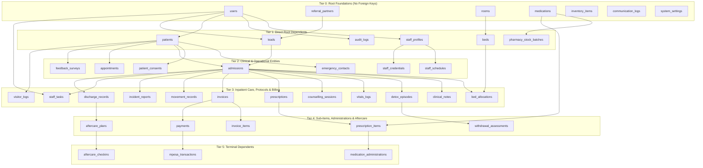

# Calyvia Wellness Center — Database Dependency Map & Schema DAG

**System:** Calyvia Wellness Center HMIS/EMR  
**Database:** PostgreSQL 16 (Hosted Supabase Cloud)  
**Schema:** `public` (domain models) & `storage` (buckets)  
**Total Domain Tables:** 40  

---

## 1. Topological Tier Hierarchy (DAG)

To guarantee error-free idempotent execution, database tables are structured in a strict **Directed Acyclic Graph (DAG)**. Tables in higher tiers depend only on tables in equal or lower tiers.

---

## 2. Table-by-Table Foreign Key Reference Matrix

| Table Name | Tier | Primary Key | Foreign Key Columns & Targets | ON DELETE Rule |
|:--|:--|:--|:--|:--|
| `users` | 0 | `id` (UUID) | `approved_by` -> `users(id)` | SET NULL / NO ACTION |
| `referral_partners` | 0 | `id` (UUID) | *None* | N/A |
| `rooms` | 0 | `id` (UUID) | *None* | N/A |
| `medications` | 0 | `id` (UUID) | *None* | N/A |
| `inventory_items` | 0 | `id` (UUID) | *None* | N/A |
| `communication_logs` | 0 | `id` (UUID) | *None* | N/A |
| `system_settings` | 0 | `id` (UUID) | *None* | N/A |
| `staff_profiles` | 1 | `id` (UUID) | `user_id` -> `users(id)` | CASCADE |
| `audit_logs` | 1 | `id` (UUID) | `user_id` -> `users(id)` | SET NULL |
| `patients` | 1 | `id` (UUID) | `registered_by_id` -> `users(id)` | RESTRICT |
| `leads` | 1 | `id` (UUID) | `referral_partner_id` -> `referral_partners(id)` `assigned_to_id` -> `users(id)` | SET NULL SET NULL |
| `beds` | 1 | `id` (UUID) | `room_id` -> `rooms(id)` | CASCADE |
| `pharmacy_stock_batches`| 1 | `id` (UUID) | `medication_id` -> `medications(id)` | CASCADE |
| `staff_schedules` | 2 | `id` (UUID) | `staff_profile_id` -> `staff_profiles(id)` | CASCADE |
| `staff_credentials` | 2 | `id` (UUID) | `staff_profile_id` -> `staff_profiles(id)` | CASCADE |
| `emergency_contacts` | 2 | `id` (UUID) | `patient_id` -> `patients(id)` | CASCADE |
| `patient_consents` | 2 | `id` (UUID) | `patient_id` -> `patients(id)` `witnessed_by_id` -> `users(id)` | CASCADE RESTRICT |
| `admissions` | 2 | `id` (UUID) | `patient_id` -> `patients(id)` `lead_id` -> `leads(id)` | RESTRICT SET NULL |
| `appointments` | 2 | `id` (UUID) | `patient_id` -> `patients(id)` `doctor_id` -> `users(id)` | CASCADE RESTRICT |
| `feedback_surveys` | 2 | `id` (UUID) | `patient_id` -> `patients(id)` | SET NULL |
| `bed_allocations` | 3 | `id` (UUID) | `admission_id` -> `admissions(id)` `bed_id` -> `beds(id)` | CASCADE RESTRICT |
| `clinical_notes` | 3 | `id` (UUID) | `admission_id` -> `admissions(id)` `author_id` -> `users(id)` | CASCADE RESTRICT |
| `detox_episodes` | 3 | `id` (UUID) | `admission_id` -> `admissions(id)` `supervising_doctor_id` -> `users(id)` | CASCADE RESTRICT |
| `vitals_logs` | 3 | `id` (UUID) | `admission_id` -> `admissions(id)` `recorded_by_id` -> `users(id)` | CASCADE RESTRICT |
| `counselling_sessions` | 3 | `id` (UUID) | `admission_id` -> `admissions(id)` `counsellor_id` -> `users(id)` | CASCADE RESTRICT |
| `prescriptions` | 3 | `id` (UUID) | `admission_id` -> `admissions(id)` `prescribing_doctor_id` -> `users(id)` | CASCADE RESTRICT |
| `invoices` | 3 | `id` (UUID) | `admission_id` -> `admissions(id)` | CASCADE |
| `movement_records` | 3 | `id` (UUID) | `admission_id` -> `admissions(id)` `approved_by_id` -> `users(id)` | CASCADE RESTRICT |
| `visitor_logs` | 3 | `id` (UUID) | `patient_id` -> `patients(id)` | CASCADE |
| `incident_reports` | 3 | `id` (UUID) | `reported_by_id` -> `users(id)` `admission_id` -> `admissions(id)` | RESTRICT SET NULL |
| `staff_tasks` | 3 | `id` (UUID) | `assigned_to_id` -> `users(id)` `created_by_id` -> `users(id)` | CASCADE CASCADE |
| `discharge_records` | 3 | `id` (UUID) | `admission_id` -> `admissions(id)` `primary_physician_id` -> `users(id)` | RESTRICT RESTRICT |
| `withdrawal_assessments`| 4 | `id` (UUID) | `detox_episode_id` -> `detox_episodes(id)` `assessed_by_id` -> `users(id)` | CASCADE RESTRICT |
| `prescription_items` | 4 | `id` (UUID) | `prescription_id` -> `prescriptions(id)` `medication_id` -> `medications(id)` | CASCADE RESTRICT |
| `invoice_items` | 4 | `id` (UUID) | `invoice_id` -> `invoices(id)` | CASCADE |
| `payments` | 4 | `id` (UUID) | `invoice_id` -> `invoices(id)` `received_by_id` -> `users(id)` | RESTRICT RESTRICT |
| `aftercare_plans` | 4 | `id` (UUID) | `patient_id` -> `patients(id)` `discharge_record_id` -> `discharge_records(id)` | RESTRICT SET NULL |
| `medication_administrations` | 5 | `id` (UUID) | `prescription_item_id` -> `prescription_items(id)` `administered_by_id` -> `users(id)` | CASCADE RESTRICT |
| `mpesa_transactions` | 5 | `id` (UUID) | `payment_id` -> `payments(id)` | SET NULL |
| `aftercare_checkins` | 5 | `id` (UUID) | `aftercare_plan_id` -> `aftercare_plans(id)` `conducted_by_id` -> `users(id)` | CASCADE RESTRICT |

---

## 3. Custom PostgreSQL ENUM Definitions

All 16 custom ENUMs are declared with `duplicate_object` exception handling:

1. `"UserRole"`: `SUPER_ADMIN`, `FACILITY_ADMIN`, `MEDICAL_DIRECTOR`, `DOCTOR_PSYCHIATRIST`, `NURSE`, `COUNSELLOR`, `PHARMACIST`, `ADMISSIONS_FRONT_DESK`, `FINANCE_BILLING`, `INVENTORY_STORE`, `MANAGEMENT_EXECUTIVE`
2. `"PatientStatus"`: `ENQUIRY`, `TRIAGE`, `ADMITTED_DETOX`, `ADMITTED_REHAB`, `ON_LEAVE`, `DISCHARGED`, `AFTERCARE`, `DECEASED`
3. `"Gender"`: `MALE`, `FEMALE`, `OTHER`
4. `"AdmissionType"`: `VOLUNTARY`, `FAMILY_ESCORTED`, `MEDICAL_TRANSFER`, `COURT_ORDERED`
5. `"ProgramType"`: `DETOX_ONLY`, `REHAB_30_DAYS`, `REHAB_60_DAYS`, `REHAB_90_DAYS`, `OUTPATIENT`, `AFTERCARE_ONLY`
6. `"NoteType"`: `PSYCHIATRIC_EVALUATION`, `DOCTOR_CLINICAL_NOTE`, `NURSING_SHIFT_NOTE`, `MDT_REVIEW`, `COUNSELLING_PROGRESS`
7. `"DetoxProtocolType"`: `ALCOHOL_CIWA`, `OPIOID_COWS`, `SEDATIVE_TAPER`, `POLY_SUBSTANCE`
8. `"ScoreType"`: `CIWA_AR`, `COWS`
9. `"AssessmentSeverity"`: `MILD`, `MODERATE`, `SEVERE`
10. `"RoomType"`: `DETOX_WARD`, `INPATIENT_MALE`, `INPATIENT_FEMALE`, `VIP_PRIVATE`, `HIGH_DEPENDENCY_UNIT`
11. `"BedStatus"`: `AVAILABLE`, `OCCUPIED`, `MAINTENANCE`, `RESERVED`
12. `"InvoiceStatus"`: `DRAFT`, `ISSUED`, `PARTIALLY_PAID`, `FULLY_PAID`, `VOID`
13. `"PaymentMethod"`: `MPESA_STK`, `MPESA_C2B`, `BANK_TRANSFER`, `CASH`, `INSURANCE_COPAY`
14. `"IncidentSeverity"`: `LOW`, `MEDIUM`, `HIGH`, `CRITICAL`
15. `"TaskPriority"`: `LOW`, `MEDIUM`, `HIGH`, `URGENT`
16. `"TaskStatus"`: `PENDING`, `IN_PROGRESS`, `COMPLETED`, `OVERDUE`, `CANCELLED`

---

## 4. Trigger & Automation Inventory

| Trigger Identifier | Target Table | Event | Function Invoked | Guard Condition |
|:--|:--|:--|:--|:--|
| `trg_<tbl>_updated_at` | 12 tables (`users`, `patients`, `leads`, `admissions`, etc.) | `BEFORE UPDATE` | `public.handle_updated_at()` | Table exists (`to_regclass IS NOT NULL`) |
| `trg_sync_bed_occupancy` | `public.bed_allocations` | `AFTER INSERT OR UPDATE` | `public.sync_bed_occupancy()` | Syncs `beds.status` (`OCCUPIED` / `AVAILABLE`) |
| `trg_audit_clinical_notes` | `public.clinical_notes` | `AFTER INSERT OR UPDATE OR DELETE` | `public.log_clinical_audit_event()` | Emits immutable audit log with old/new JSON payloads |
| `trg_audit_admissions` | `public.admissions` | `AFTER INSERT OR UPDATE OR DELETE` | `public.log_clinical_audit_event()` | Emits admission episode audit trace |

---

## 5. Storage Buckets & Policies

| Bucket ID | Access Tier | Size Limit | Allowed MIME Types | Intended Clinical Usage |
|:--|:--|:--|:--|:--|
| `patient-documents` | Private | 50 MB | PDF, PNG, JPEG, JPG | Admission contracts, signed digital consent forms |
| `medical-records` | Private | 50 MB | PDF, PNG, JPEG, JPG, DICOM | External laboratory panels, brain scans, psychiatric assessments |
| `prescriptions` | Private | 20 MB | PDF, PNG, JPEG, JPG | Scanned doctor prescriptions, signed prescription audits |
| `system-assets` | Public | 10 MB | PNG, JPEG, SVG, WebP, PDF | Calyvia center logo, hospital letterheads, public intake forms |
